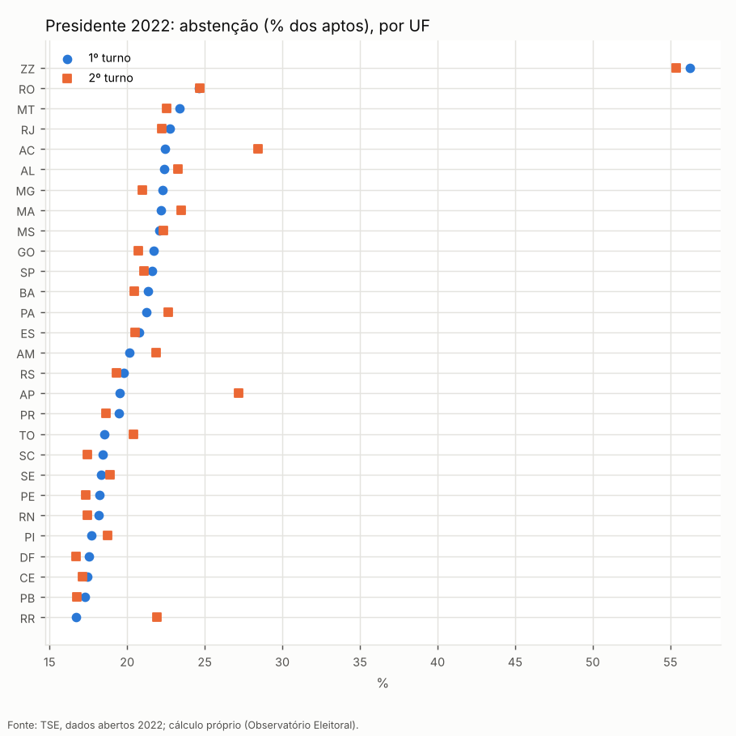
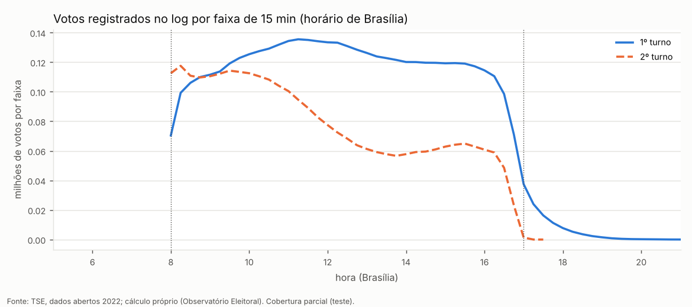
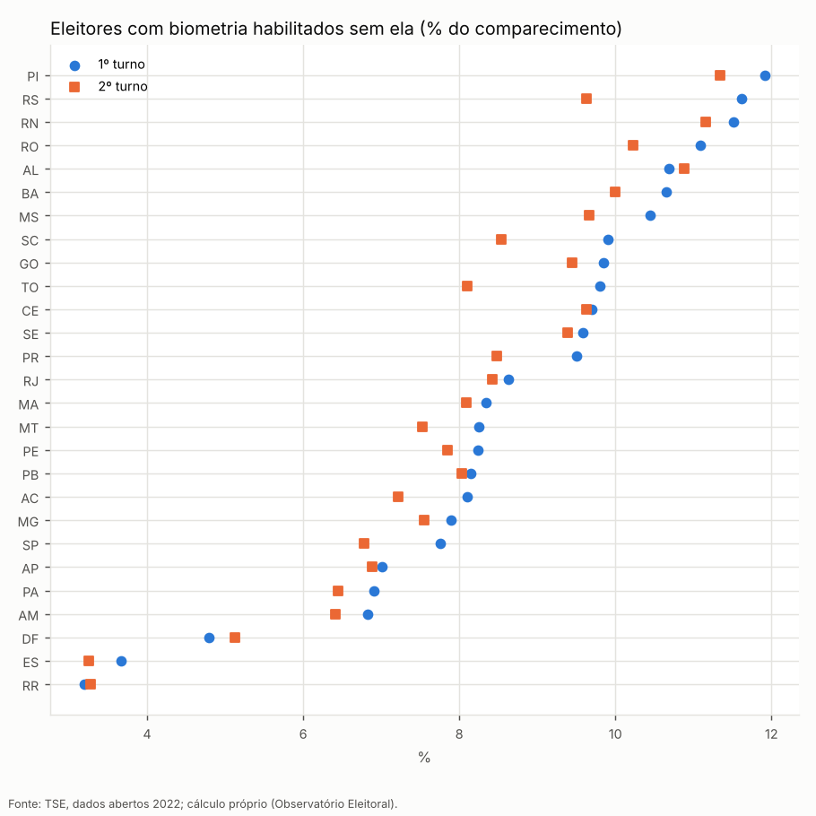
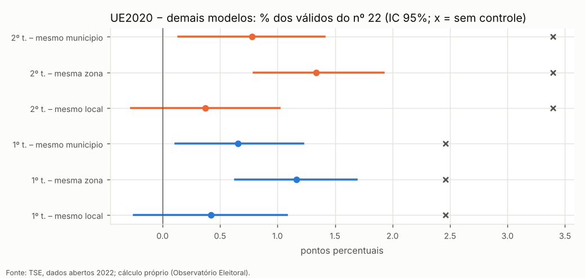

# Relatório público — o que os dados oficiais das eleições presidenciais mostram

_Versão de 27/10/2026. Todos os números foram calculados por nós a partir dos arquivos publicados pelo TSE. Detalhes técnicos em `docs/auditoria-2022.md` e `docs/metodologia.md`._

## Em uma frase

Somando os boletins de cada uma das cerca de 472 mil seções eleitorais de 2022, chegamos exatamente aos totais oficiais; os mesmos números aparecem iguais nas diferentes publicações do TSE e no arquivo gerado pela própria urna. Encontramos poucas divergências pontuais entre o log de algumas urnas e o boletim, todas listadas, a maioria com explicação documentada (troca de urna, apuração em cédula).

### As contas nacionais de 2022 fecham?

**Classificação:** Conferido

- **O que verificamos?** Somamos os Boletins de Urna de todas as seções e comparamos com os totais oficiais.
- **O que os números mostram?** 1º turno: 123.682.372 eleitores votaram de 156.453.354 aptos nas seções instaladas (abstenção 20,95%); brancos 1,59% e nulos 2,82% de quem votou. 2º turno: 124.252.796 votaram (abstenção 20,58%); brancos 1,42%, nulos 3,16%. Lula: 60.345.999 (50,90% dos válidos); Bolsonaro: 58.206.354 (49,10%).
- **O que significa?** Os totais oficiais são exatamente a soma dos boletins das seções.
- **Existe explicação conhecida?** A única diferença (657 eleitores aptos) são eleitores de 47 seções que não chegaram a ser instaladas.
- **O que ainda não sabemos?** —
- **Como conferir?** `resultados/2022/resultados_brasil.csv`; comparação com o TSE em `docs/auditoria-2022.md`.

### O boletim publicado é o mesmo que a urna gerou?

**Classificação:** Conferido, com incompatibilidades pontuais documentadas

- **O que verificamos?** Comparamos, seção por seção, o boletim publicado em tabela com o arquivo binário assinado que cada urna transmitiu, com duas outras tabelas do TSE e com o log (diário de eventos) da urna.
- **O que os números mostram?** 20 de 32 comparações sem nenhuma diferença. Restam 260 diferenças sem explicação documental, todas entre o log de poucas urnas e o boletim.
- **O que significa?** Votos e totais coincidem em todas as publicações; as diferenças restantes estão no registro de eventos, não nos votos publicados.
- **Existe explicação conhecida?** Casos explicados: seções que votaram em cédula após falha da urna, troca de urna com logs de várias seções no mesmo pacote, urna desligada no meio de um voto.
- **O que ainda não sabemos?** Os casos restantes precisam da ata da mesa receptora (documento físico) para serem esclarecidos.
- **Como conferir?** `resultados/2022/incompatibilidades.csv` e diagnósticos em `resultados/2022/diagnosticos/`.

### Houve votos fora do horário?

**Classificação:** Conferido

- **O que verificamos?** Convertemos o relógio de cada urna para o horário de Brasília (a urna marca hora local) e contamos os votos antes das 8h e depois das 17h.
- **O que os números mostram?** Antes das 8h: 0 votos no 1º turno e 0 no 2º. Depois das 17h: 3,51% dos votos no 1º turno e 0,033% no 2º (nas seções com log processado).
- **O que significa?** Votar depois das 17h é permitido para quem está na fila. No 1º turno havia 5 cargos, o que alonga as filas.
- **Existe explicação conhecida?** Fila com senha às 17h (Resolução TSE 23.669/2021, art. 136).
- **O que ainda não sabemos?** O log não registra quem recebeu senha.
- **Como conferir?** `resultados/2022/temporal_por_uf.csv`; gráfico abaixo.

### Quantos votaram sem a digital reconhecida?

**Classificação:** Conferido

- **O que verificamos?** Contamos, no boletim e no log, quem tinha biometria cadastrada mas foi liberado pelo mesário.
- **O que os números mostram?** 1º turno: 8,7% de quem votou; 2º turno: 8,1% de quem votou.
- **O que significa?** É o procedimento previsto quando a digital falha; boletim e log dão o mesmo número.
- **Existe explicação conhecida?** Regra das até 4 tentativas e liberação pelo mesário (Res. 23.669/2021, arts. 113–114). Urnas mais novas (modelo 2020) têm taxa menor.
- **O que ainda não sabemos?** O motivo de cada falha não é registrado.
- **Como conferir?** `resultados/2022/biometria_por_uf.csv`.

### A urna modelo 2020 teve resultado diferente?

**Classificação:** Diferença estatística em controles fracos; sem diferença no controle forte

- **O que verificamos?** Comparamos seções com urna 2020 e com outros modelos no mesmo local de votação.
- **O que os números mostram?** No mesmo local, a diferença na proporção de votos de cada candidato não é estatisticamente significativa; em comparações mais amplas (mesma zona) aparece diferença de cerca de 1 ponto, que pode refletir bairros diferentes.
- **O que significa?** Não há evidência de efeito do modelo; a distribuição das urnas não é aleatória.
- **Existe explicação conhecida?** Logística de distribuição por zona e local.
- **O que ainda não sabemos?** Sem dados de eleições anteriores por seção, não é possível separar totalmente local e modelo.
- **Como conferir?** `resultados/2022/modelos_efeito_controlado.csv`; gráfico abaixo.

### E 2026?

**Classificação:** Conferido (1º turno) / Pendente (2º turno)

- **O que verificamos?** Os mesmos procedimentos aplicados a 2026. Do 2º turno, só as tabelas oficiais por seção já foram publicadas.
- **O que os números mostram?** 1º turno de 2026: 125.275.835 votantes de 158.745.007 aptos (abstenção 21,08%); brancos 1,84%, nulos 2,93%. 2º turno (tabelas oficiais por seção): 128.236.074 votantes (abstenção 19,22%); Lula 64.256.232 (51,79% dos válidos), Flávio Bolsonaro 59.826.041 (48,21%); a identidade válidos = comparecimento − brancos − nulos fecha com resíduo 0.
- **O que significa?** Os totais por seção reproduzem o resultado oficial; a diferença em votos válidos corresponde aos votos dados a um candidato posteriormente considerados nulos ("nulos técnicos").
- **Existe explicação conhecida?** Ver `docs/auditoria-2026.md`.
- **O que ainda não sabemos?** Segundo turno de 2026: BU, logs e arquivos das urnas aguardando publicação.
- **Como conferir?** `docs/auditoria-2026.md` e `docs/comparativo-historico.md`.

## Como ler as classificações

**Conferido**: refizemos a conta e bate. **Diferença explicada**: havia diferença, mas existe documento que a explica. **Diferença estatística**: um padrão se afasta de uma referência, sem erro documental. **Incompatibilidade documental**: fontes oficiais que deveriam bater não batem, e ainda não sabemos por quê. **Pendente**: faltam dados. Nenhuma dessas categorias, sozinha, é prova de irregularidade.

